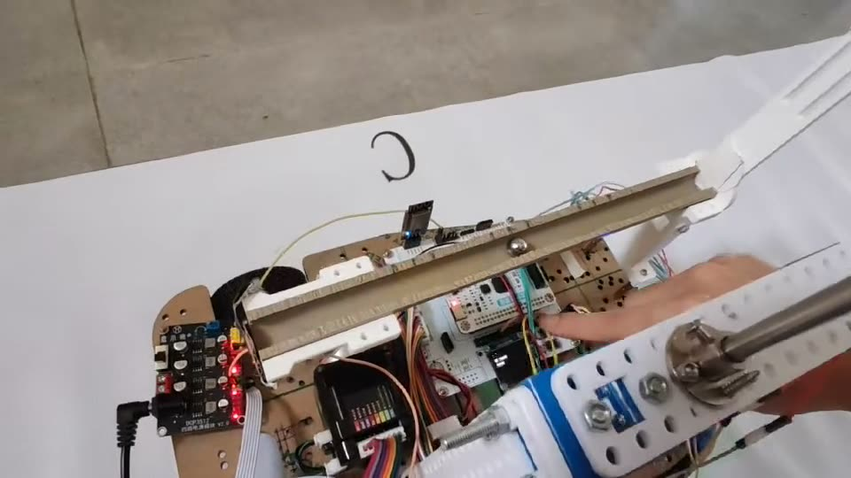
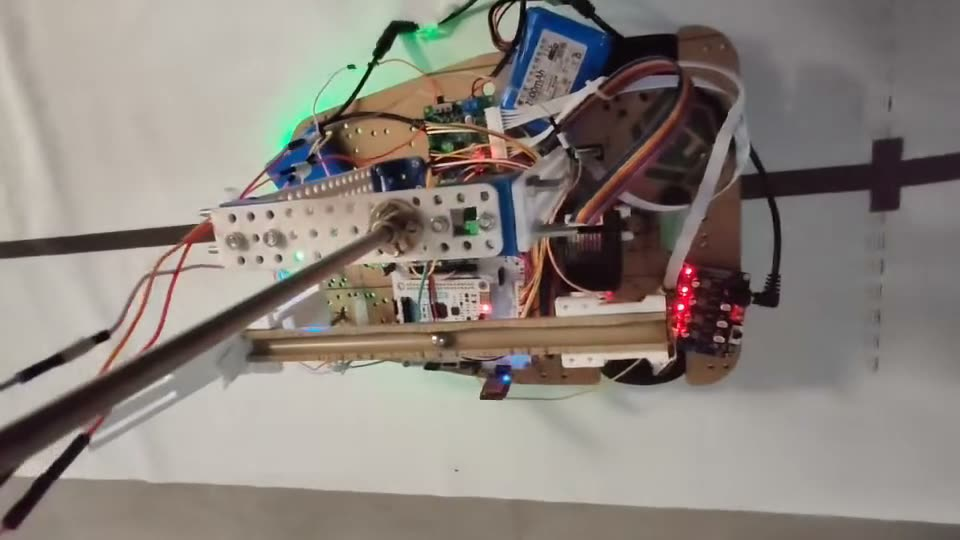

# ⚽ 车载平衡滚球运动控制系统 · 2026 电赛 H 题

> **MCU 端固件**：让钢球在飞驰的小车上，稳稳停在你想让它停的地方。🐣

[](https://www.ti.com/)


📽️ [实机演示](https://doinnothin.github.io/TI-Cup-2026-H-MSPM0/demo/) ·
📄 [赛题原文](docs/assets/NUEDC-2026-H-problem.pdf) ·
🧭 [架构文档](docs/architecture.md) ·
🧪 [测试与证据](docs/testing.md)

基于 **TI MSPM0G3507** 的车载平衡滚球运动控制系统固件，覆盖 **第 2～6 问（Q2–Q6）**：视觉串口反馈、球位置闭环、摆杆几何映射、X42S 步进执行器控制，以及第 4/5/6 问共用的车辆运动控制状态机。视觉识别算法运行在外部视觉模块上，不在本仓库范围内。

## 🧭 目录

- [✨ 项目亮点](#features) · [📽️ 实机演示](#demo) · [🏗️ 系统架构](#arch) · [⚙️ 控制方案](#control)
- [🎯 题目覆盖](#coverage) · [📁 目录结构](#structure) · [🔧 硬件平台](#hardware) · [🛠️ 技术栈](#stack)
- [🚀 快速开始](#quickstart) · [🧪 验证与证据](#verify) · [📚 文档导航](#docs) · [⚠️ 已知限制](#limits) · [👤 作者](#author)

<a id="features"></a>
## ✨ 项目亮点

- 🎯 **双系统耦合解耦**：小车运动会对钢球产生惯性扰动，难点在"车 + 球"两个系统的耦合；用共享车辆状态机 + 模式门控复用已验证控制律，避免重复造轮子。
- 👁️ **只靠位置也能稳**：视觉只有位置观测、约 150 ms 延迟，用 **α-β 估计**把速度作为阻尼项，不虚构"速度内环"，结构贴合真实可观测条件。
- 🛑 **预测性制动**：按停车距离 `d_stop = |v|·T + v²/(2·a_brake) + margin` 提前反向阻尼，而不是到点才刹车。
- 🧲 **静摩擦起步补偿**：针对机构的静摩擦死区，用"方向相关的一次性起步脉冲 + 有界保持"，检测到真实运动就释放，而不是积分硬顶。
- 🧩 **分层清晰**：应用层（q3/q4/q6）、板级（bsp）、驱动协议（code）解耦；厂商 SDK 与生成代码隔离，不手改。
- 📝 **注释与文档全中文**：核心源码注释、全部 Markdown 文档已完成中文化，代码逻辑零改动（`strip-comment` 校验一致）。

<a id="demo"></a>
## 📽️ 实机演示

> 第 3～6 问的实际硬件运行录像（已转 MP4 / H.264，主流浏览器与播放器可直接播放）。

| 题目 | 演示内容 | 视频 |
|---|---|---|
| 第 3 问 | 静止状态下滚球按任务流程完成位置切换 | [▶ 播放 Q3](https://doinnothin.github.io/TI-Cup-2026-H-MSPM0/demo/#q3) |
| 第 4 问 | 静态底盘运行 + 滚球恢复保持 | [▶ 播放 Q4](https://doinnothin.github.io/TI-Cup-2026-H-MSPM0/demo/#q4) |
| 第 5 问 | 动态底盘 + 滚球控制 | [▶ 播放 Q5](https://doinnothin.github.io/TI-Cup-2026-H-MSPM0/demo/#q5) |
| 第 6 问 | 目标捕获 + 相对目标闭环 | [▶ 播放 Q6](https://doinnothin.github.io/TI-Cup-2026-H-MSPM0/demo/#q6) |

<p align="center">
  <a href="docs/demo/q4_poster.jpg"></a>
  <a href="docs/demo/q5_poster.jpg"></a>
</p>
<p align="center"><sub>▲ Q4 静态底盘恢复 / Q5 动态底盘滚球控制（实机运行画面）</sub></p>

<a id="arch"></a>
## 🏗️ 系统架构

```text
底盘：灰度 / 编码器 → 路线状态机与速度闭环 → 底盘驱动

视觉：视觉模块 → UART3 新帧接收与有效性门控 → 球位置/速度估计
                                              ├─ 第 3 问控制流程
                                              └─ 第 4/5/6 问共用车辆控制状态机
                                                   ├─ Q6 目标捕获 / 显式目标
                                                   ├─ Q5/Q6 运动状态前馈
                                                   └─ 摆杆几何映射 → X42S 执行器

前台协作调度（10 ms）：视觉收帧 → 执行器反馈 → 球控 → 车辆状态机 → 日志 → OLED
TIMG6 / UART / GPIO 中断：时基、收发与事件采集
```

<a id="control"></a>
## ⚙️ 控制方案

整条控制链（MCU 侧）：

```text
视觉 UART3 新帧 → 帧校验/新鲜度门控 → α-β 状态估计（位置 x、速度 v）
  → 球位置外环 PD（物理摆杆角域） → 停车距离预判制动 → 摆杆角限幅/轨迹整形
  → 摆杆几何映射（角→高度/电机角） → X42S 绝对角度命令 → 电机内部 FOC 闭环
```

几个关键设计：

1. **事件驱动外环**：每个新视觉帧触发一次外环计算，而不是固定高频空转；视觉不可信时按"保持 → 超时 → 故障"分级处理，坏帧不打断控制。
2. **α-β 估计 + 创新门控**：单帧异常跳变被拒绝，同方向连续跳变才重新捕获，防止一个错误坐标制造巨大 D 项。
3. **预测性制动**：用停车距离模型估算触发点，提前反向阻尼；越过目标后 PID 的位置项与 D 项继续向减速方向作用。
4. **静摩擦起步补偿**：PD 输出不足以破静摩擦时，临时抬升到已辨识的起步角，检测到位移立即释放，再交回 PD 做预测制动。
5. **运动前馈**：Q5 把底盘转弯的 `v²/R` 横向加速度与纵向加速度折算成倾角前馈，抵消车辆机动对球的扰动。

<a id="coverage"></a>
## 🎯 题目覆盖

| 题目 | 主要代码 | 功能 |
|---|---|---|
| Q2 | `user/bsp/lap_trace.*`、`user/main.c` | 底盘循迹绕行 / 定距行驶 |
| Q3 | `user/app/q3/` | 球状态估计、位置闭环、摆杆几何标定、中心→+5→-5 状态流程 |
| Q4 | `user/app/q4/q45_vehicle_control.*` | 静态底盘路径 + 滚球恢复与保持 |
| Q5 | `user/app/q4/q5_*`、`q45_vehicle_control.*` | 动态底盘与滚球控制、运动状态前馈 |
| Q6 | `user/app/q6/`、`q45_vehicle_control.*` | 目标捕获 / 显式目标、相对目标闭环 |

> 第 4/5/6 问共用车辆控制状态机；第 6 问的目标捕获与专属调节由 Q6 路径隔离，没有重写已验收的第 3～5 问控制律。

<a id="structure"></a>
## 📁 目录结构

```text
├── user/
│   ├── main.c              # 启动、按键路由、主循环任务编排
│   ├── app/q3/             # 第 3 问：估计器、外环 PD、几何标定、状态序列
│   ├── app/q4/             # 第 4/5/6 问共享车辆控制、Q5 模型/前馈、Q4 静态恢复
│   ├── app/q6/             # 第 6 问目标捕获与视觉准入策略
│   ├── app/ball_actuator/  # 摆杆执行器抽象与标定
│   ├── app/                # 按键输入、状态显示、遥测节奏适配
│   ├── bsp/                # 时钟、中断、底盘控制、PID、循迹
│   └── code/               # 设备驱动与协议（X42S、视觉帧、OLED、编码器、陀螺仪…）
├── docs/                   # 架构 / 控制 / 硬件 / 验证 / 调试案例 / 已知限制 / 赛题
├── tests/                  # 主机侧回归测试（ARM 模拟器执行）
├── tools/                  # 串口采集、日志分析、绘图脚本
├── include/ · source/core/ # TI DriverLib / CMSIS / zf 第三方库（未改动）
└── empty.syscfg            # 硬件配置源（生成的 ti_msp_dl_config.* 已入库、勿手改）
```

<a id="hardware"></a>
## 🔧 硬件平台

| 项 | 规格 |
|---|---|
| 主控 | TI **MSPM0G3507**（Arm Cortex-M0+，LQFP-64） |
| 摆杆执行器 | 张大头 **X42S** 步进电机（X 固件，内部 FOC/角度闭环），UART0 |
| 视觉输入 | 外部视觉模块 → **UART3**（`AA 55` 帧，带序号/时间戳/置信度/CRC16） |
| 底盘 | 电机 / PWM + 编码器测速 + 八路灰度循迹 |
| 调试遥测 | **UART1** 日志；**UART2** 陀螺仪 |
| 控制时基 | **TIMG6** 10 ms 中断 |
| 人机交互 | 按键选择题目与启停，OLED 显示状态 |

> ⚠️ 接线前请核对 [硬件说明](docs/hardware.md)；外设名称必须与实际接线一致，不能凭旧日志推测端口职责。

<a id="stack"></a>
## 🛠️ 技术栈

| 类别 | 使用 |
|---|---|
| 语言 / 规范 | C11、裸机（无 RTOS）、协作式 10 ms 调度 + 中断 |
| 工具链 | CMake 3.22+、Ninja、Arm GNU Toolchain（GCC） |
| 芯片 SDK | TI MSPM0 SDK、SysConfig、DriverLib、CMSIS-Core |
| 控制算法 | α-β 状态估计、PD 外环、停车距离预测制动、静摩擦补偿、运动前馈 |
| 通信协议 | 自定义视觉串口帧（`AA 55` + CRC16）、X42S 步进协议 |
| 验证 | 主机 C 回归（Arm GCC + Unicorn 模拟器）、Python 数据分析工具 |

<a id="quickstart"></a>
## 🚀 快速开始

**构建固件**（CMake + Ninja + Arm GNU 工具链）：

```powershell
$env:ARM_GCC_ROOT = "C:\Toolchains\arm-gnu-toolchain"
$env:NINJA_ROOT   = "C:\Tools\ninja"
cmake --preset debug-armgcc
cmake --build --preset build-debug
```

**运行主机回归测试**（需要 Arm GCC；通过 Unicorn 模拟器执行）：

```powershell
python -m pip install -r tests/requirements.txt --target build/testdeps
powershell -ExecutionPolicy Bypass -File tests/run_q5_checks.ps1
powershell -ExecutionPolicy Bypass -File tests/run_q6_checks.ps1
```

> 详细环境要求见 [源码与构建基线](docs/baseline.md)。`user/app/q6/q6_config.h` 中的台架宏与竞赛固件相互独立，实机前务必检查 CMake 缓存与宏定义。

<a id="verify"></a>
## 🧪 验证与证据

- ✅ **主机回归**（ARM 模拟器）：按键输入 9 项、遥测 14 项、Q5 5,664 项、Q6 目标 235 项 / 静态镜像 39 项，全部零失败。
- ✅ **ARM 构建**：Debug 固件构建通过（Flash 约 100,968 / 131,072 字节，SRAM 约 17,672 / 32,768 字节）。
- ✅ **实机**：用户报告 **第 5、6 问已通过实机验收**（具体数据以对应日期日志与现场条件为准）。
- ⚠️ **证据边界**：编译/模拟通过 ≠ 实机正确；历史参数与结论的可信级别见 [测试与证据](docs/testing.md) 与 [已知限制](docs/known-limitations.md)。

<a id="docs"></a>
## 📚 文档导航

| 文档 | 内容 |
|---|---|
| [架构与模块职责](docs/architecture.md) | 运行时流程、层级职责、变更边界 |
| [控制流程](docs/control-algorithm.md) | 各问控制路径与 Q6 目标捕获 |
| [硬件与外设归属](docs/hardware.md) | 引脚、按键映射、运行时安全边界 |
| [源码与构建基线](docs/baseline.md) | 快照身份、工具链、固件变体 |
| [测试与证据](docs/testing.md) | 证据分级、回归范围、记录模板 |
| [调试案例](docs/debugging-case-studies.md) | 7 个可复用的故障定位经验 |
| [已知限制](docs/known-limitations.md) | 范围与验证边界 |
| [第三方声明](THIRD_PARTY_NOTICES.md) | TI SDK / CMSIS 许可 |

<a id="limits"></a>
## ⚠️ 已知限制

- 本仓库**不含第 1 问的视觉识别算法/固件**，只含 MCU 侧 UART3 数据消费与控制侧帧校验。
- 硬件结果依赖具体条件；历史调参探索不等同于已验证结论。
- 尚未选定顶层开源许可证；在作者确定前，请勿默认第一方代码可自由复用。
- 第三方 TI SDK / CMSIS 代码保留原始许可与声明，详见 [第三方声明](THIRD_PARTY_NOTICES.md)。

<a id="author"></a>
## 👤 作者与许可

- 作者 / 维护：[@doinnothin](https://github.com/doinnothin)
- 仓库：<https://github.com/doinnothin/TI-Cup-2026-H-MSPM0>
- 许可证：暂未选定（License: TBD）
